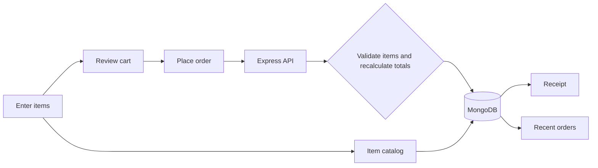
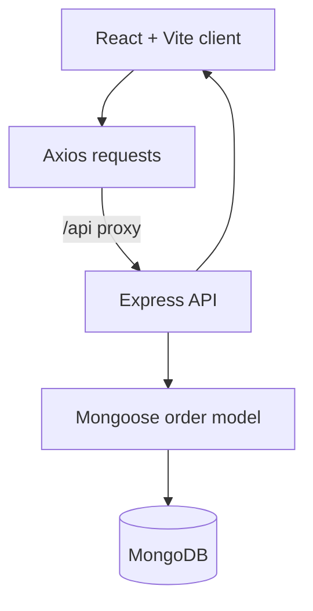

**Stack Used:**

[](https://react.dev/)
[](https://vite.dev/)
[](https://axios-http.com/)
[](https://nodejs.org/)
[](https://expressjs.com/)
[](https://www.mongodb.com/)
[](https://mongoosejs.com/)

## SwiftTill Point of Sale

> A lightweight checkout flow for building an order, saving it, and printing a customer receipt.

SwiftTill brings inventory, item entry, cart totals, order history, and receipt printing into one small point-of-sale app. The React client talks to an Express API, which stores inventory items and validates completed orders in MongoDB.

| Checkout | Order records |
| --- | --- |
| Add items with a name, price, and quantity; review and remove cart lines | Save completed orders, browse recent receipts, and reopen a receipt for printing |

<p align="center">
	<strong>Manage the catalog. Build the cart. Keep a receipt for every order.</strong>
</p>

<p align="center">
	<a href="#getting-started">Quick start</a> ·
	<a href="#request-flow">Request flow</a> ·
	<a href="#api-overview">API</a> ·
	<a href="#troubleshooting">Troubleshooting</a>
</p>

## The Product In One Minute

| | Capability | What it does |
| --- | --- | --- |
| **01** | Inventory catalog | Store item names and unit prices for reuse in Billing |
| **02** | Item entry | Use catalog suggestions or add a new item with price and quantity |
| **03** | Live totals | Preview line totals and the current order total |
| **04** | Checkout | Submit a non-empty order to the API |
| **05** | Persistent history | Store orders in MongoDB and show the 20 most recent |
| **06** | Printable receipt | View a saved receipt and print it from the browser |

## Request Flow



The client sends item names, prices, and quantities. The server validates those values and calculates line totals and the grand total before saving the order. The saved order is returned to the client as a receipt.

## Architecture At A Glance



The Vite development server proxies `/api` requests to Express on port `5000`. MongoDB stores orders and their item lines; the browser handles cart editing and receipt printing.

## Tech Stack

| Layer | Technology |
| --- | --- |
| Frontend | React 18, Vite 5 |
| HTTP client | Axios |
| Backend | Node.js, Express 4 |
| Database | MongoDB with Mongoose 8 |

## Project Structure

```text
pos-system/
├── client/
│   ├── src/
	│   │   ├── App.jsx          # Billing, inventory, cart, and recent orders
│   │   ├── Receipt.jsx      # Receipt view and print action
│   │   ├── index.css        # App and print styles
│   │   └── main.jsx         # React entry point
│   ├── index.html
│   ├── package.json
│   └── vite.config.js       # Dev server and API proxy
├── server/
	│   ├── models/Item.js       # Inventory item schema
	│   ├── models/Order.js      # Order and item schemas
	│   ├── routes/items.js      # Inventory API endpoints
	│   ├── routes/orders.js     # Order API endpoints
│   ├── .env.example         # Local server configuration template
│   ├── package.json
│   └── server.js            # Express and MongoDB entry point
└── README.md
```

## Getting Started

### Prerequisites

- Node.js 18 or newer
- MongoDB running locally or a MongoDB connection URI

### 1. Configure and start the API

```bash
cd server
npm install
cp .env.example .env
npm run dev
```

The server reads `PORT` and `MONGO_URI` from `server/.env`. The example file uses port `5000` and the local database `mongodb://127.0.0.1:27017/pos_system`.

### 2. Start the client

Open a second terminal:

```bash
cd client
npm install
npm run dev
```

Open [http://localhost:5173](http://localhost:5173). The Vite server forwards `/api` requests to `http://localhost:5000`.

## API Overview

Inventory endpoints use `/api/items`; order endpoints use `/api/orders`.

| Method | Endpoint | Purpose |
| --- | --- | --- |
| `GET` | `/api/orders` | Return the 20 most recent orders |
| `POST` | `/api/orders` | Validate and save an order; returns the saved receipt |
| `GET` | `/api/orders/:id` | Find one order by its MongoDB ID |
| `GET` | `/api/items` | Return catalog items sorted by name |
| `POST` | `/api/items` | Add or update a catalog item by name |
| `DELETE` | `/api/items/:id` | Delete an inventory item |
| `DELETE` | `/api/orders/:id` | Delete a saved receipt |

### Create an order

```http
POST /api/orders
Content-Type: application/json
```

```json
{
	"items": [
		{ "name": "Espresso", "price": 3.5, "quantity": 2 }
	]
}
```

The API derives item totals and `grandTotal` from the submitted prices and quantities. A successful response includes the saved items, `receiptNo`, `grandTotal`, and timestamps. Invalid or empty orders return a `400` response with a message. Billing saves catalog items when they are added to the cart; matching names reuse the existing item entry.

## Validation

Build the client:

```bash
cd client
npm run build
```

Check the server entry point:

```bash
node --check server/server.js
```

## Troubleshooting

| Symptom | Check |
| --- | --- |
| The API exits during startup | Confirm MongoDB is running and `MONGO_URI` in `server/.env` is reachable |
| The client cannot load orders | Confirm the API is running on port `5000`; the Vite proxy targets that port |
| Checkout fails | Confirm the cart has at least one item and each item has a name, non-negative price, and quantity of at least `1` |
| Orders do not appear after restart | Confirm the API and client are connected to the same MongoDB database |

## Scope

SwiftTill supports a persistent item catalog and order receipts. Inventory tracks item names and unit prices, not on-hand quantities. It does not include user accounts, taxes, discounts, or payment processing.
